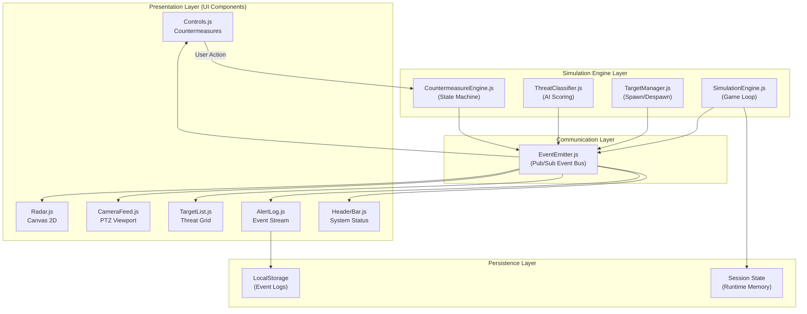
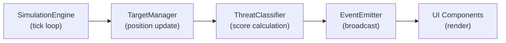
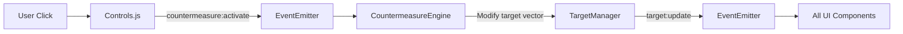
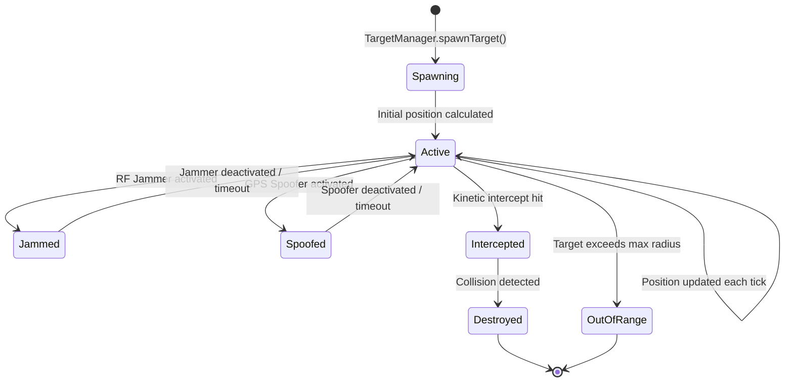
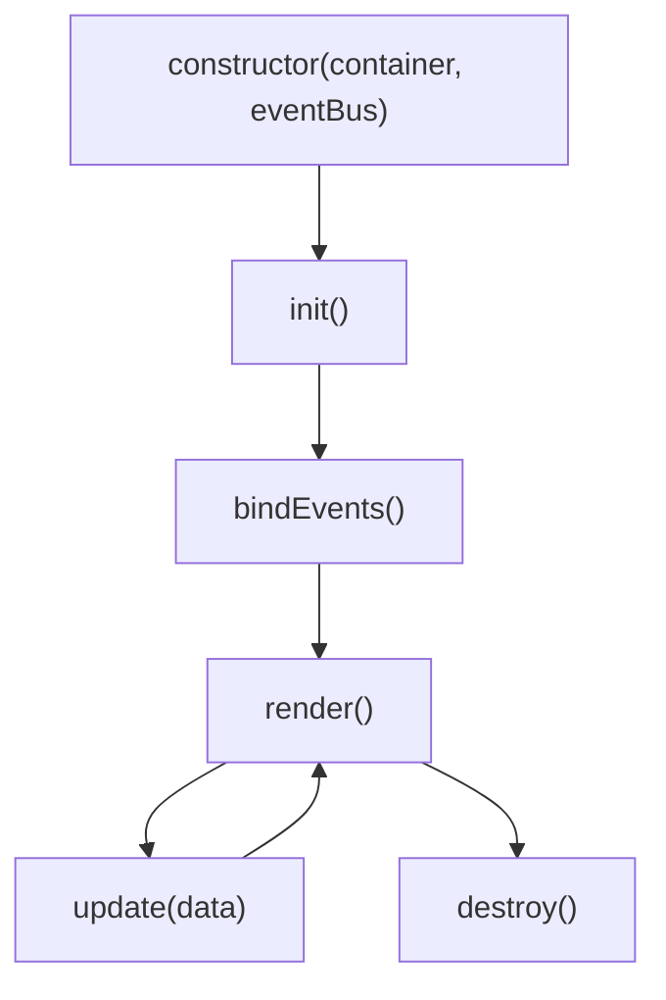
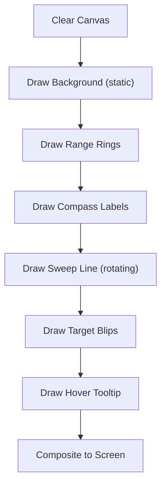
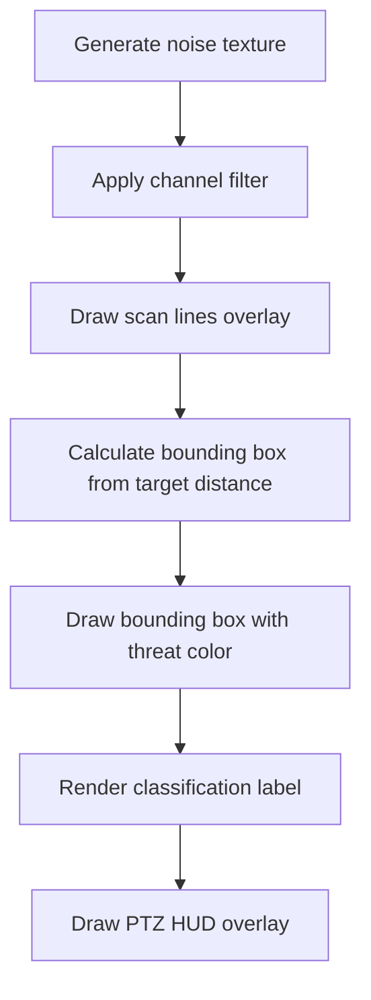
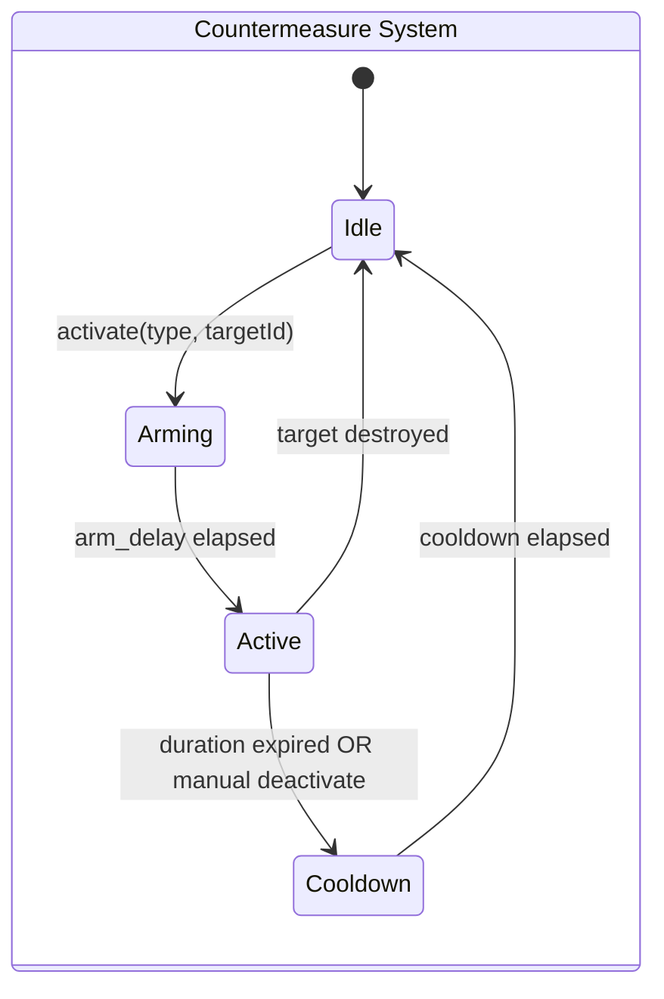
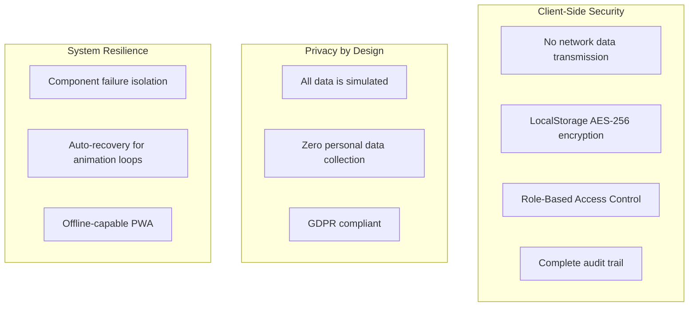
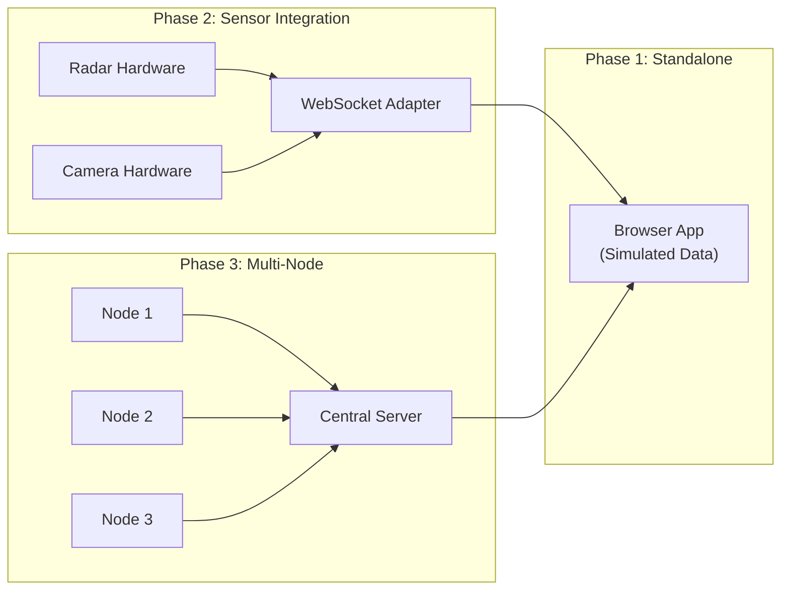

# AeroGuard AI — System Architecture

> **Project**: AI-Based Counter-Drone Detection & Threat Classification System
> **Team**: AeroGuard AI — Centre for Defence Technology & Innovation
> **Stack**: Vite 5.x · Vanilla JS (ES6+) · Canvas 2D API · Lucide Icons · Vitest
> **Last Updated**: 2026-07-13

---

## 1. Architecture Overview

AeroGuard AI follows a **three-layer architecture** with strict unidirectional data flow. The system is entirely client-side, running in a modern browser with zero backend dependencies.



---

## 2. Layer Descriptions

### 2.1 Simulation Engine Layer

The core computation layer. Runs headlessly — produces data events without knowledge of the UI.

| Module | Responsibility | Key APIs |
|--------|---------------|----------|
| **`SimulationEngine.js`** | Orchestrates the main game loop via `requestAnimationFrame`. Manages tick rate, pause/resume, and delegates to sub-engines | `start()`, `stop()`, `pause()`, `resume()`, `tick(deltaTime)` |
| **`TargetManager.js`** | Spawns UAV targets with randomized initial state vectors. Manages active target pool. Handles despawn conditions (out-of-range, destroyed) | `spawnTarget()`, `removeTarget(id)`, `getActiveTargets()`, `updatePositions(dt)` |
| **`ThreatClassifier.js`** | Computes Threat Score (TS) from telemetry vector $\mathbf{x} = [v, a, s, b]$. Classifies into 4 tiers. Re-evaluates on every tick | `classify(target)`, `getThreshold(score)`, `setWeights(w)` |
| **`CountermeasureEngine.js`** | Finite state machine for countermeasure effects. Modifies target vectors based on active countermeasures | `activate(type, targetId)`, `deactivate(type, targetId)`, `getStatus(targetId)` |

### 2.2 Communication Layer

| Module | Responsibility |
|--------|---------------|
| **`EventEmitter.js`** | Central pub/sub bus. All inter-module communication flows through typed events. Supports wildcard listeners and one-time subscriptions |

### 2.3 Presentation Layer

Each UI component is a self-contained ES6 class that:
1. Subscribes to relevant events from the Event Bus
2. Maintains its own DOM subtree
3. Renders updates efficiently (RAF-batched for Canvas, DOM diffing for lists)

| Component | Renders | Input Events | Output Events |
|-----------|---------|-------------|---------------|
| **`Radar.js`** | Canvas 2D polar radar with sweep, blips, rings | `target:update`, `target:spawn`, `target:destroy` | `radar:targetHover`, `radar:targetSelect` |
| **`CameraFeed.js`** | Simulated PTZ camera viewport with bounding boxes | `target:update`, `camera:lock` | `camera:channelSwitch` |
| **`TargetList.js`** | Threat-sorted target cards with filters | `target:update`, `target:spawn`, `target:destroy`, `threat:reclassify` | `targetlist:select`, `targetlist:filter` |
| **`Controls.js`** | Countermeasure action panel | `target:select`, `countermeasure:status` | `countermeasure:activate` |
| **`AlertLog.js`** | Persistent scrollable event log | `alert:log`, `countermeasure:activate`, `threat:reclassify` | `log:export` |
| **`HeaderBar.js`** | System status indicators | `target:update`, `engine:status` | — |

### 2.4 Persistence Layer

| Store | Technology | Purpose | Capacity |
|-------|-----------|---------|----------|
| **Event Logs** | `localStorage` | Alert history, countermeasure actions, threat reclassifications | ~5 MB (FIFO at 500 entries) |
| **Session State** | In-memory (JS objects) | Active targets, engine configuration, UI state | Runtime only |

---

## 3. Data Flow Architecture

### 3.1 Primary Data Flow (Unidirectional)



**Data never flows backward** — UI components dispatch user actions as new events, which the engine processes on the next tick.

### 3.2 User Action Flow



### 3.3 Target Lifecycle



---

## 4. Simulation Engine Deep Dive

### 4.1 Game Loop Architecture

```
┌──────────────────────────────────────────┐
│           requestAnimationFrame          │
│                                          │
│  ┌────────────────────────────────────┐  │
│  │  1. Calculate deltaTime (Δt)      │  │
│  │  2. TargetManager.updateAll(Δt)   │  │
│  │  3. ThreatClassifier.classifyAll()│  │
│  │  4. CountermeasureEngine.tick(Δt) │  │
│  │  5. EventEmitter.flush()          │  │
│  │  6. Schedule next frame           │  │
│  └────────────────────────────────────┘  │
│                                          │
│  Target: 60 FPS (16.67ms per frame)      │
└──────────────────────────────────────────┘
```

### 4.2 Target State Vector

Each target maintains the following state:

```javascript
{
  id: "TGT-001",           // Unique identifier
  type: "quadcopter",      // UAV type classification

  // Position (polar coordinates)
  r: 450,                  // Radial distance (meters)
  theta: 2.35,             // Bearing angle (radians)

  // Velocity
  v: 12.5,                 // Radial velocity (m/s)
  omega: 0.02,             // Angular velocity (rad/s)

  // Physical properties
  altitude: 120,           // Meters above ground
  rcs: 0.3,                // Radar Cross Section (m²)

  // Classification
  behaviorPattern: 0.6,    // 0.0 (hover) → 1.0 (direct ingress)
  threatScore: 72,         // Computed by ThreatClassifier
  threatLevel: "WARNING",  // Enum: FALSE_POSITIVE | LOW | WARNING | CRITICAL

  // Status
  status: "ACTIVE",        // Enum: ACTIVE | JAMMED | SPOOFED | INTERCEPTED | DESTROYED
  countermeasures: [],     // Active countermeasures applied

  // Cartesian (derived for rendering)
  x: 0,                   // Computed: x_c + r·cos(θ)
  y: 0                    // Computed: y_c + r·sin(θ)
}
```

### 4.3 Threat Scoring Model

$$\text{TS} = w_v \cdot f(v) + w_a \cdot g(a) + w_s \cdot h(s) + w_b \cdot k(b)$$

| Factor | Weight | Normalization Function | Risk Mapping |
|--------|--------|----------------------|--------------|
| Speed $v$ | $w_v = 25$ | $f(v) = \min(v / 30, 1.0)$ | >20 m/s = high risk |
| Altitude $a$ | $w_a = 20$ | $g(a) = 1 - |a - a_{danger}| / a_{max}$ | Near perimeter boundaries = high risk |
| RCS $s$ | $w_s = 25$ | $h(s) = \min(s / 2.0, 1.0)$ | Larger = heavier payload = higher risk |
| Behavior $b$ | $w_b = 30$ | $k(b) = b$ | Direct ingress (1.0) vs hover (0.2) |

**Classification Thresholds**:

| Range | Level | Label | Color |
|-------|-------|-------|-------|
| TS < 25 | `FALSE_POSITIVE` | Bird / Weather Balloon | `hsl(120, 60%, 50%)` — Green |
| 25 ≤ TS < 60 | `LOW` | Commercial Quadcopter (Light) | `hsl(200, 70%, 55%)` — Blue |
| 60 ≤ TS < 85 | `WARNING` | Commercial Drone (Heavy Payload) | `hsl(45, 90%, 55%)` — Amber |
| TS ≥ 85 | `CRITICAL` | Weaponized / Military UAV | `hsl(0, 80%, 55%)` — Red |

---

## 5. UI Component Architecture

### 5.1 Component Lifecycle

Every component follows a standardized lifecycle:



### 5.2 Dashboard Layout (CSS Grid)

```
┌──────────────────────────────────────────────────────────┐
│                    HEADER BAR                            │
│  [System Status] [Active Targets] [Threat Level] [Time] │
├──────────────────────┬───────────────────────────────────┤
│                      │                                   │
│   RADAR PANEL        │   CAMERA FEED PANEL               │
│   (Canvas 2D)        │   (PTZ Viewport)                  │
│   360° Sweep         │   Bounding Boxes                  │
│   Target Blips       │   Classification Labels           │
│                      │   Channel: [Optical|Thermal|IR]   │
│                      │                                   │
├──────────────────────┼───────────────────────────────────┤
│                      │                                   │
│   TARGET LIST        │   CONTROLS PANEL                  │
│   (Threat-Sorted)    │   [RF Jam] [GPS Spoof]           │
│   [Filter: All ▼]    │   [Intercept] [Alarm]            │
│   TGT-001 ██ CRIT    │   Cooldown: ████░░ 60%           │
│   TGT-003 ██ WARN    │                                   │
│   TGT-002 ██ LOW     │   ALERT LOG                      │
│                      │   [Filter ▼] [Search] [Export]    │
│                      │   14:32:01 ⚠ TGT-001 → CRITICAL  │
│                      │   14:31:45 ℹ TGT-003 spawned     │
│                      │   14:31:12 🛡 RF Jam on TGT-002  │
└──────────────────────┴───────────────────────────────────┘
```

**CSS Grid Definition**:
```css
.dashboard {
  display: grid;
  grid-template-columns: 1fr 1fr;
  grid-template-rows: auto 1fr 1fr;
  grid-template-areas:
    "header    header"
    "radar     camera"
    "targets   controls-log";
  gap: 12px;
  height: 100vh;
  padding: 12px;
}
```

### 5.3 Responsive Breakpoints

| Breakpoint | Layout | Behavior |
|-----------|--------|----------|
| **≥1200px** (Desktop) | 2-column grid, all panels visible | Full dashboard experience |
| **768–1199px** (Tablet) | Single column, stacked panels | Radar and camera stacked, scrollable |
| **<768px** (Mobile) | Tabbed navigation | One panel visible at a time, bottom tab bar |

---

## 6. Event Bus Specification

### 6.1 Event Types

| Event | Payload | Emitter | Subscribers |
|-------|---------|---------|-------------|
| `target:spawn` | `{ target }` | TargetManager | Radar, TargetList, AlertLog |
| `target:update` | `{ targets[] }` | TargetManager | Radar, CameraFeed, TargetList, HeaderBar |
| `target:destroy` | `{ targetId, reason }` | TargetManager | Radar, TargetList, AlertLog |
| `threat:reclassify` | `{ targetId, oldLevel, newLevel }` | ThreatClassifier | TargetList, AlertLog, HeaderBar |
| `target:select` | `{ targetId }` | Radar, TargetList | CameraFeed, Controls, Radar, TargetList |
| `countermeasure:activate` | `{ type, targetId }` | Controls | CountermeasureEngine, AlertLog |
| `countermeasure:status` | `{ type, targetId, status }` | CountermeasureEngine | Controls, AlertLog |
| `alert:log` | `{ level, message, timestamp }` | Any | AlertLog |
| `engine:status` | `{ running, fps, targetCount }` | SimulationEngine | HeaderBar |
| `camera:lock` | `{ targetId }` | Controls, TargetList | CameraFeed |
| `camera:channelSwitch` | `{ channel }` | CameraFeed | — |
| `log:export` | `{ format }` | AlertLog | — |

### 6.2 Event Bus API

```javascript
class EventEmitter {
  on(event, callback)       // Subscribe
  off(event, callback)      // Unsubscribe
  once(event, callback)     // One-time subscription
  emit(event, payload)      // Publish
  flush()                   // Process queued events
}
```

---

## 7. Rendering Architecture

### 7.1 Radar Canvas Pipeline



**Optimization Strategy**:
- **Static layer**: Background, range rings, compass — rendered once to off-screen canvas, composited each frame
- **Dynamic layer**: Sweep line, target blips — rendered every frame
- **Interaction layer**: Tooltips — rendered on mouse move only
- **Performance budget**: Total frame time < 16ms for 60 FPS

### 7.2 Camera Feed Rendering



---

## 8. Countermeasure State Machine



### Effect Matrix

| Countermeasure | State Modification | Duration | Cooldown |
|----------------|-------------------|----------|----------|
| **RF Jammer** | $v \to 0$, randomize $\omega$, SNR → 0 | 10s | 15s |
| **GPS Spoofing** | Gradually shift $\theta$ away from center | 15s | 20s |
| **Kinetic Intercept** | Launch interceptor blip from center toward target; on collision → `DESTROYED` | Until hit | 30s |
| **Audible Alert** | No target modification; triggers audio chime | Toggle | None |

---

## 9. Security Architecture



### Access Control Model

| Role | Radar View | Camera Feed | Target List | Countermeasures | Admin Controls |
|------|-----------|-------------|-------------|-----------------|----------------|
| **Observer** | ✅ | ✅ | ✅ | ❌ | ❌ |
| **Operator** | ✅ | ✅ | ✅ | ✅ (Jam, Spoof, Alarm) | ❌ |
| **Commander** | ✅ | ✅ | ✅ | ✅ (All, including Kinetic) | ✅ |

---

## 10. Directory Structure

```
AeroGuard-AI/
├── index.html                  # Entry point — semantic HTML5 shell
├── vite.config.js             # Vite configuration
├── package.json               # Dependencies and scripts
├── vitest.config.js           # Test configuration
│
├── src/
│   ├── main.js                # Application bootstrap
│   ├── App.js                 # Dashboard assembly & layout
│   │
│   ├── engine/                # Simulation Engine Layer
│   │   ├── SimulationEngine.js
│   │   ├── TargetManager.js
│   │   ├── ThreatClassifier.js
│   │   ├── CountermeasureEngine.js
│   │   └── EventEmitter.js
│   │
│   ├── components/            # Presentation Layer
│   │   ├── Radar.js
│   │   ├── CameraFeed.js
│   │   ├── TargetList.js
│   │   ├── Controls.js
│   │   ├── AlertLog.js
│   │   └── HeaderBar.js
│   │
│   ├── utils/                 # Shared utilities
│   │   ├── math.js            # Polar ↔ Cartesian, normalization
│   │   ├── constants.js       # Threat thresholds, colors, config
│   │   ├── storage.js         # LocalStorage wrapper
│   │   └── audio.js           # Web Audio API helpers
│   │
│   ├── styles/                # CSS Design System
│   │   ├── index.css          # Root variables, resets, typography
│   │   ├── layout.css         # Grid system, responsive breakpoints
│   │   ├── components.css     # Component-specific styles
│   │   └── glassmorphism.css  # Glass effect utilities
│   │
│   └── assets/                # Static assets
│       └── icons/             # Custom icon overrides
│
├── tests/                     # Test suite
│   ├── engine/
│   │   ├── SimulationEngine.test.js
│   │   ├── TargetManager.test.js
│   │   ├── ThreatClassifier.test.js
│   │   └── CountermeasureEngine.test.js
│   └── components/
│       ├── Radar.test.js
│       └── AlertLog.test.js
│
├── memory-bank/               # Project documentation
│   ├── AI-Based Counter-Drone Detection & Threat Classification System.md
│   ├── technical_workflows.md
│   ├── implementation_plan.md
│   ├── progress.md
│   └── architecture.md
│
└── public/                    # Static public assets
    ├── favicon.ico
    └── manifest.json
```

---

## 11. Technology Stack Summary

| Layer | Technology | Purpose |
|-------|-----------|---------|
| **Build** | Vite 5.x | HMR, fast builds, ES module bundling |
| **Language** | Vanilla JavaScript (ES6+) | Zero framework overhead, maximum performance |
| **Markup** | HTML5 Semantic | Accessible, SEO-friendly structure |
| **Styling** | CSS3 (HSL Variables, Grid, Flexbox) | Design system with glassmorphism |
| **Rendering** | Canvas 2D API | High-performance radar visualization |
| **Icons** | Lucide Icons (SVG/CDN) | Consistent, lightweight icon set |
| **Audio** | Web Audio API | Audible threat alerts |
| **Storage** | LocalStorage | Persistent event logs (client-side) |
| **Testing** | Vitest | Unit + integration tests with coverage |
| **Deployment** | GitHub Pages / Vercel / Netlify | Static site hosting with CI/CD |

---

## 12. Compliance & Standards Alignment

| Standard | Status | Notes |
|----------|--------|-------|
| NATO STANAG 4778 | Designed for compatibility | C-UAS interoperability protocol alignment |
| ISO 27001 | Aligned | Information security management practices |
| GDPR | Compliant | Zero PII collection, privacy-by-design |
| WCAG 2.1 AA | Targeted | Keyboard navigation, ARIA labels, color contrast |

---

## 13. Scalability Architecture



The architecture is designed with clear extension points:
- **Sensor Adapter Interface**: `TargetManager` can be replaced with a `LiveTargetAdapter` consuming WebSocket data
- **Multi-Radar Fusion**: `SimulationEngine` supports multiple `TargetManager` instances for composite airspace views
- **AI Model Swapping**: `ThreatClassifier` exposes a `setModel()` API for plugging in TensorFlow.js models
- **Real-time Collaboration**: Event Bus can be bridged to WebRTC or WebSocket for shared situation awareness
