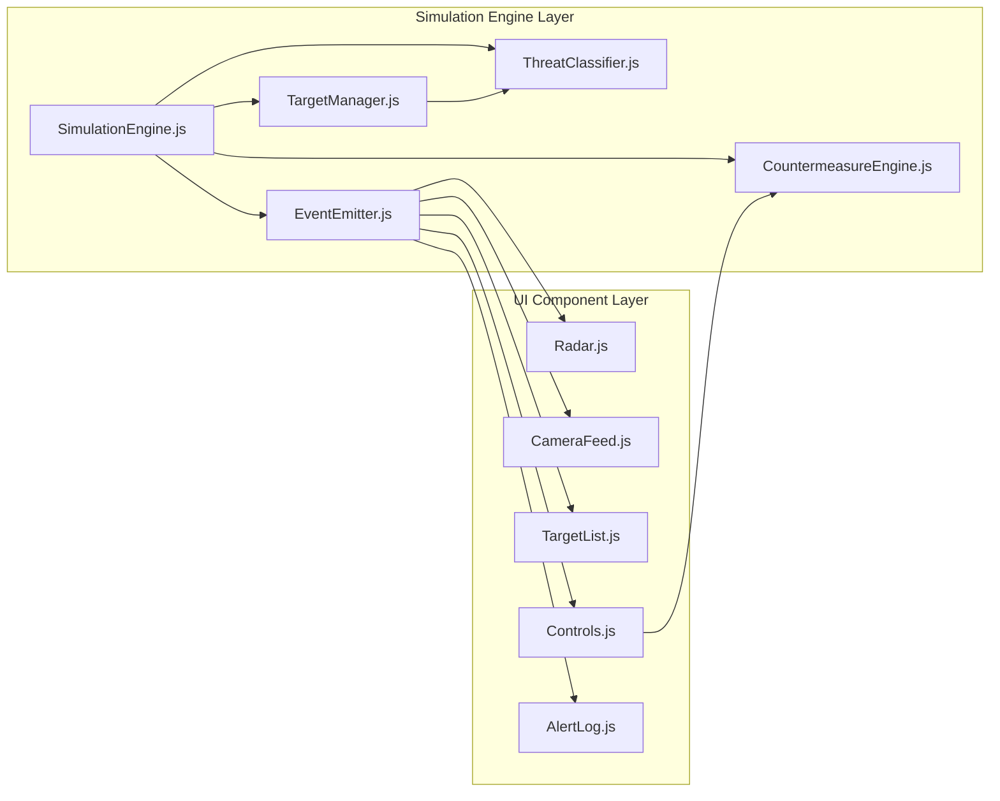

# AeroGuard AI — Implementation Plan

> **Project**: AI-Based Counter-Drone Detection & Threat Classification System
> **Team**: AeroGuard AI — Centre for Defence Technology & Innovation
> **Stack**: Vite 5.x · Vanilla JS (ES6+) · Canvas 2D API · Lucide Icons · Vitest
> **Last Updated**: 2026-07-13

---

## 1. Executive Summary

AeroGuard AI is a **premium browser-based Counter-UAS Operations Dashboard** that combines a 360° radar visualizer, AI-powered threat classifier, multi-channel camera feeds, countermeasure controls, and persistent event logging — all running client-side with zero backend dependencies.

This plan details the full engineering lifecycle: from project scaffolding through simulation engine development, UI component construction, integration testing, and deployment readiness.

---

## 2. Phased Implementation Roadmap

### Phase 1 — Project Foundation & Scaffolding
**Duration**: 1–2 days
**Goal**: Establish the project skeleton, tooling, and design system.

| # | Task | Details |
|---|------|---------|
| 1.1 | **Initialize Vite project** | `npm create vite@latest ./ -- --template vanilla`, configure `vite.config.js` with path aliases |
| 1.2 | **Define directory structure** | `/src/components/`, `/src/engine/`, `/src/utils/`, `/src/styles/`, `/src/assets/`, `/tests/` |
| 1.3 | **Setup CSS design system** | HSL-based CSS custom properties: `--hue-primary`, `--hue-critical`, `--hue-warning`, `--hue-safe`. Glassmorphism utility classes, dark theme tokens |
| 1.4 | **Install dependencies** | `lucide` (icons), `vitest` (testing), optional: `@vitest/coverage-v8` |
| 1.5 | **Configure Vitest** | `vitest.config.js` with DOM environment, coverage thresholds |
| 1.6 | **Setup linting & formatting** | ESLint + Prettier with consistent code style rules |
| 1.7 | **Create `index.html` shell** | Semantic HTML5 layout with grid regions: sidebar, radar-panel, camera-panel, target-panel, controls-panel, log-panel |

**Deliverable**: Running `npm run dev` opens a styled but empty dashboard shell.

---

### Phase 2 — Simulation Engine (Core Logic)
**Duration**: 3–4 days
**Goal**: Build the headless simulation engine that drives all UI components.

| # | Task | Details |
|---|------|---------|
| 2.1 | **`SimulationEngine.js`** | Central orchestrator: manages the game loop via `requestAnimationFrame`, maintains target registry, emits events |
| 2.2 | **`TargetManager.js`** | Spawns/despawns simulated UAV targets with randomized initial parameters (position, speed, altitude, RCS, behavior) |
| 2.3 | **Trajectory Model** | Polar coordinate system. Position updates: $\theta_t = \theta_{t-1} + \omega \cdot \Delta t + \epsilon_\theta$ and $r_t = r_{t-1} + v \cdot \Delta t + \epsilon_r$ with Gaussian noise $\epsilon \sim \mathcal{N}(0, \sigma^2)$ |
| 2.4 | **`ThreatClassifier.js`** | Weighted scoring: $\text{TS} = w_v \cdot f(v) + w_a \cdot g(a) + w_s \cdot h(s) + w_b \cdot k(b)$. Normalization functions map each telemetry field to $[0, 1]$. Classify into 4 tiers: False Positive (<25), Low (25–59), Warning (60–84), Critical (≥85) |
| 2.5 | **`CountermeasureEngine.js`** | State machine for RF Jam, GPS Spoof, Kinetic Intercept, Audible Alert. Each modifies target vectors per the Countermeasure State Matrix |
| 2.6 | **Event Bus (`EventEmitter.js`)** | Pub/sub system for decoupled component communication: `target:spawn`, `target:update`, `target:destroy`, `threat:reclassify`, `countermeasure:activate`, `alert:log` |
| 2.7 | **Unit tests for engine** | Vitest tests for trajectory math, threat scoring, countermeasure state transitions, event emission |

**Deliverable**: Engine runs in isolation with console-logged telemetry. All unit tests pass with >90% coverage on engine modules.

---

### Phase 3 — UI Component Development
**Duration**: 4–5 days
**Goal**: Build each dashboard panel as a self-contained ES6 module.

#### 3A — Radar Visualizer (`Radar.js`)
| # | Task | Details |
|---|------|---------|
| 3A.1 | **Canvas setup** | Responsive `<canvas>` element, DPI-aware rendering, dark background with concentric range rings |
| 3A.2 | **Polar sweep animation** | Rotating sweep line at configurable RPM, gradient trail with alpha fade |
| 3A.3 | **Target blip rendering** | Color-coded blips by threat level. Blip size proportional to RCS. Pulsing animation for Critical targets |
| 3A.4 | **Hover telemetry tooltip** | Mouse proximity detection on blips → glassmorphic tooltip showing ID, type, speed, altitude, bearing, threat score |
| 3A.5 | **Range ring labels** | Distance markers at 25%, 50%, 75%, 100% of max range |
| 3A.6 | **Performance budget** | Target: 60 FPS sustained. Use `requestAnimationFrame`, off-screen canvas for static elements, dirty-rect optimization |

#### 3B — Camera Feed (`CameraFeed.js`)
| # | Task | Details |
|---|------|---------|
| 3B.1 | **Simulated feed viewport** | Dark viewport with scan-line overlay and PTZ HUD (azimuth, elevation, zoom indicators) |
| 3B.2 | **Bounding box overlay** | Dynamic bounding box: $w_{box} = S \cdot f_{lens} / r$, color-coded by threat level, tracks highest-priority target |
| 3B.3 | **Classification label** | Overlay showing target ID, classification label, confidence score (%), threat level badge |
| 3B.4 | **Channel switcher** | Tabs for Optical / Thermal / IR channels with visual filter effects (grayscale, inverted, heat-map) |

#### 3C — Target List (`TargetList.js`)
| # | Task | Details |
|---|------|---------|
| 3C.1 | **Threat-sorted grid** | Card-based or table layout sorted by threat score descending. Color-coded left border strip |
| 3C.2 | **Per-target details** | ID, classification, speed, altitude, bearing, RCS, threat score, status (Active / Jammed / Spoofed / Destroyed) |
| 3C.3 | **Filter controls** | Dropdown/toggle filters: All, Critical, Warning, Low, False Positive |
| 3C.4 | **Selection interaction** | Click a target → highlights on radar, locks camera feed to that target |

#### 3D — Countermeasure Controls (`Controls.js`)
| # | Task | Details |
|---|------|---------|
| 3D.1 | **Control panel layout** | 4 action buttons: RF Jammer, GPS Spoofer, Kinetic Intercept, Air-Raid Alarm |
| 3D.2 | **Target selection binding** | Controls are context-aware — disabled when no target selected, label shows selected target ID |
| 3D.3 | **Activation animation** | Button press → ripple effect → status indicator (spinner → success/failure). Confirmation modal for Kinetic Intercept |
| 3D.4 | **Cooldown timers** | Visual cooldown progress bar after activation (configurable per countermeasure) |
| 3D.5 | **Audio toggle** | Toggle switch for audible alerts on Critical threats with Web Audio API chime |

#### 3E — Alert Log (`AlertLog.js`)
| # | Task | Details |
|---|------|---------|
| 3E.1 | **Event stream UI** | Scrollable log with timestamp, event type icon, message, and threat level badge |
| 3E.2 | **LocalStorage persistence** | All events serialized to `localStorage` with automatic pruning (max 500 entries FIFO) |
| 3E.3 | **Filter & search** | Filter by threat level, event type. Text search across messages |
| 3E.4 | **Export functionality** | "Download CSV" button for log export |
| 3E.5 | **Session recovery** | On page load, restore and display previous session's log entries |

**Deliverable**: Each component renders independently and responds to engine events via the Event Bus. Visual polish matches glassmorphism design language.

---

### Phase 4 — Integration & Assembly
**Duration**: 2–3 days
**Goal**: Wire all components into a cohesive dashboard.

| # | Task | Details |
|---|------|---------|
| 4.1 | **Dashboard layout (`App.js`)** | CSS Grid master layout. Responsive breakpoints: desktop (all panels), tablet (stacked), mobile (tabbed navigation) |
| 4.2 | **Engine ↔ UI binding** | Connect `SimulationEngine` events to all five component update methods |
| 4.3 | **Cross-component interaction** | Target selection syncs across Radar ↔ TargetList ↔ CameraFeed ↔ Controls |
| 4.4 | **Header bar** | System status indicators: active target count, highest threat level, system uptime, connection status |
| 4.5 | **Keyboard shortcuts** | `Space` = pause/resume simulation, `1-4` = activate countermeasures, `Esc` = deselect target |
| 4.6 | **Loading screen** | Animated boot sequence with system initialization messages |

**Deliverable**: Fully functional, interactive dashboard running with simulated data.

---

### Phase 5 — Testing & Quality Assurance
**Duration**: 2–3 days
**Goal**: Ensure correctness, performance, and resilience.

| # | Task | Details |
|---|------|---------|
| 5.1 | **Unit tests** | Vitest: Engine modules, utility functions, threat scoring edge cases. Target: >90% coverage |
| 5.2 | **Integration tests** | Component interaction tests: target spawn → radar render → list update → log entry |
| 5.3 | **Performance profiling** | Chrome DevTools: verify 60 FPS radar, <16ms frame budget, no memory leaks over 30-minute session |
| 5.4 | **Browser compatibility** | Test on Chrome, Firefox, Edge, Safari. Verify Canvas 2D and Web Audio API support |
| 5.5 | **Accessibility audit** | Keyboard navigation, ARIA labels on interactive elements, color contrast checks |
| 5.6 | **Error resilience** | Graceful degradation: component failure isolation, auto-recovery for animation loops |
| 5.7 | **Load testing** | Simulate 50+ simultaneous targets, verify no frame drops or UI lag |

**Deliverable**: All tests pass. Performance benchmarks documented. No critical or high-severity bugs.

---

### Phase 6 — Polish, Documentation & Deployment
**Duration**: 2–3 days
**Goal**: Production-ready build with complete documentation.

| # | Task | Details |
|---|------|---------|
| 6.1 | **Visual polish** | Micro-animations, transitions, hover effects. Final glassmorphism pass. Lucide icon consistency |
| 6.2 | **PWA manifest** | `manifest.json` + service worker for offline capability |
| 6.3 | **SEO & meta tags** | Title, description, Open Graph tags for social sharing |
| 6.4 | **README.md** | Project overview, screenshots, installation guide, architecture diagram, contribution guidelines |
| 6.5 | **Build optimization** | `vite build` — tree-shaking, code splitting, asset hashing, gzip analysis |
| 6.6 | **Deployment** | GitHub Pages / Vercel / Netlify configuration. CI/CD via GitHub Actions |
| 6.7 | **Demo recording** | Screen capture of key workflows for presentation |

**Deliverable**: Production build deployed. README complete. Demo materials ready.

---

## 3. Dependency Map

---

## 4. Risk Register

| Risk | Likelihood | Impact | Mitigation |
|------|-----------|--------|------------|
| Canvas performance degrades with >30 targets | Medium | High | Off-screen canvas caching, spatial partitioning, dirty-rect rendering |
| LocalStorage quota exceeded | Low | Medium | FIFO pruning at 500 entries, warn at 80% capacity |
| Browser compatibility issues with Canvas 2D | Low | High | Feature detection + fallback messages, polyfills where available |
| Scope creep from feature requests | Medium | Medium | Strict phase gating, defer non-core features to Phase 7 (Future) |
| Simulation realism questioned by judges | Medium | High | Document mathematical models thoroughly, show parameter tunability |

---

## 5. Definition of Done

A feature is considered **Done** when:

- [ ] Code is written and follows ES6+ module conventions
- [ ] Unit tests pass with >90% coverage on the module
- [ ] Visual output matches the glassmorphism design system
- [ ] Component responds correctly to all relevant Event Bus events
- [ ] No console errors or warnings in Chrome DevTools
- [ ] Performance budget maintained (60 FPS, <16ms frame time)
- [ ] Code reviewed and merged to main branch

---

## 6. Timeline Summary

| Phase | Duration | Cumulative |
|-------|----------|------------|
| 1 — Foundation & Scaffolding | 1–2 days | Day 2 |
| 2 — Simulation Engine | 3–4 days | Day 6 |
| 3 — UI Components | 4–5 days | Day 11 |
| 4 — Integration & Assembly | 2–3 days | Day 14 |
| 5 — Testing & QA | 2–3 days | Day 17 |
| 6 — Polish & Deployment | 2–3 days | Day 20 |

**Total Estimated Duration**: **14–20 working days**

---

## 7. Future Enhancements (Post-MVP)

These are deferred to a future phase but designed-for in the architecture:

- **Live Sensor Integration**: WebSocket adapter for real radar/camera hardware
- **Multi-Radar Fusion**: Composite airspace view from multiple sensor nodes
- **AI Model Customization**: Pluggable threat classification models (TensorFlow.js)
- **Multi-User Command Center**: WebRTC-based shared situation awareness
- **3D Airspace Visualization**: Three.js / WebGL upgrade path
- **Mobile Responsive PWA**: Full touch-optimized interface
