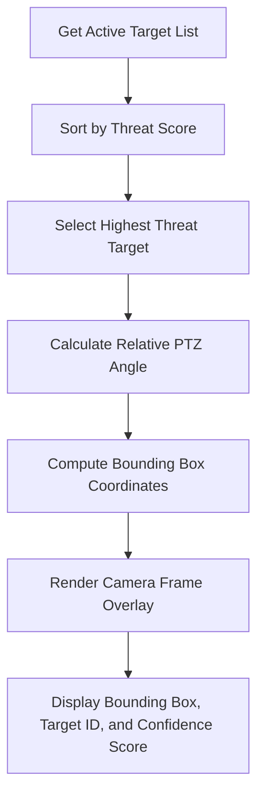

# Technical Workflows & Simulation Mechanics

This document details the core mathematical models, simulation architectures, and state machines powering the AI-based Counter-Drone Detection and Threat Classification System.

---

## 1. Airspace Simulation Engine

The simulation engine maintains a 2D/3D state vector for all active objects in the airspace. 

### Trajectory Math
Radar sweeps use polar coordinates, but the visual coordinate system on the screen uses cartesian coordinates centered at $(x_c, y_c)$ where the radar station is located.

- **Coordinate Conversion**:
  $$x = x_c + r \cdot \cos(\theta)$$
  $$y = y_c + r \cdot \sin(\theta)$$
  Where:
  - $r$ is the radial distance (in meters) from the center.
  - $\theta$ is the bearing angle (in radians) relative to true North.

- **Dynamic Vector Updates**:
  At each time step $\Delta t$, target positions are updated using standard velocity vectors, modified by a slight random walk (Brownian motion) to simulate wind turbulence or manual drone piloting:
  $$\theta_{t} = \theta_{t-1} + \omega \cdot \Delta t + \epsilon_{\theta}$$
  $$r_{t} = r_{t-1} + v \cdot \Delta t + \epsilon_{r}$$
  Where $\omega$ is angular velocity, $v$ is radial velocity, and $\epsilon \sim \mathcal{N}(0, \sigma^2)$ is Gaussian noise representing environmental drift.

---

## 2. AI Threat Classification Algorithm

To classify targets in real time, the system processes a simulated telemetry vector:
$$\mathbf{x} = [\text{Speed } (v), \text{ Altitude } (a), \text{ Radar Cross Section } (s), \text{ Behavior Pattern } (b)]$$

A weighted scoring matrix calculates the overall **Threat Score (TS)** on a $[0, 100]$ scale:
$$\text{TS} = w_v \cdot f(v) + w_a \cdot g(a) + w_s \cdot h(s) + w_b \cdot k(b)$$

Where $f, g, h, k$ are normalization functions mapping telemetry fields to $[0, 1]$ risk levels:
- **Speed ($f(v)$)**: Low speeds = lower threat, High speeds ($> 20 \text{ m/s}$) = higher threat.
- **Altitude ($g(a)$)**: Unusually low/high altitudes near perimeter boundaries raise threat score.
- **RCS ($h(s)$)**: Larger values indicate heavy payload or military-scale fixed-wing UAVs.
- **Behavior Pattern ($k(b)$)**: Straight-line ingress toward the central protected zone yields $1.0$, while hovering or random drift yields $0.2$.

### Threat Level Thresholds
Based on TS, targets are classified into four states:
- **TS < 25 (False Positive / Low)**: Classified as "Bird" or "Weather Balloon".
- **25 ≤ TS < 60 (Low Threat)**: Classified as "Commercial Quadcopter (Light)".
- **60 ≤ TS < 85 (Warning)**: Classified as "Commercial Drone (Heavy Payload/Spying)".
- **TS ≥ 85 (Critical)**: Classified as "Weaponized/Military UAV (Ingress Vector)".

---

## 3. Camera Feed AI Overlay Workflow

The Optical/Thermal tracker mimics an automated pan-tilt-zoom (PTZ) camera locking onto the highest-priority target in the airspace.

### Bounding Box Projection
To simulate 3D projection onto a 2D camera viewport, the bounding box coordinates $[x_{box}, y_{box}, w_{box}, h_{box}]$ are calculated based on target distance $r$ and size estimation $S$:
$$w_{box} = \frac{S \cdot f_{\text{lens}}}{r}$$
$$h_{box} = w_{box} \cdot \text{aspect\_ratio}$$

As a target approaches (smaller $r$), the bounding box scales up on the camera screen, adding to visual immersion.

---

## 4. Countermeasure Control Workflows

When an operator activates a countermeasure, the target's flight vector is modified via the simulation state machine.

### Countermeasure State Matrix

| Countermeasure | Simulation State Modification | Visual/UI Response |
| :--- | :--- | :--- |
| **RF Jammer** | Drops $v \to 0$ over time. Randomizes angular velocity $\omega$ to simulate uncontrolled drift. Telemetry signal-to-noise ratio drops to zero. | Radar blip flickers, camera feed overlays static, target status changes to "Jammed". |
| **GPS Spoofing** | Gradually modifies bearing $\theta$ away from the protected center coordinate $(x_c, y_c)$. | Drone trajectory curves away from the center of the radar sweep. |
| **Kinetic Intercept** | Triggers launch of an interceptor blip from center $(x_c, y_c)$ targeting drone coordinates. Upon collision, the target is removed from active radar. | Interceptor missile vector line renders; target disappears with a brief explosion animation on screen. |
| **Audible Alert Toggle**| No target modification. | Audio chimes and warnings sound on Critical threats. |
